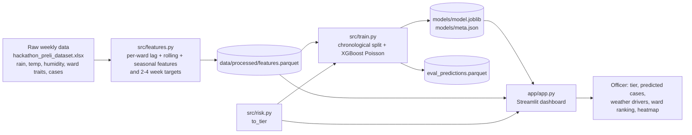

# dengAlert: Architecture

dengAlert gives public health officers a **2-to-4-week early warning** of dengue risk for each ward. It turns lagged weather and ward vulnerability into a predicted case count and a Low / Medium / High / Critical tier.

## 1. Data flow



**Stages**

1. **Ingest** (`src/features.py`): reads the weekly ward-level dataset (31,320 rows, 60 wards, 2016-2025).
2. **Feature engineering**: computed per `ward_id` on a time-sorted series, so no value crosses wards or comes from the future.
   - Rainfall lags 1 to 6 weeks, rolling rainfall sums over 2, 4 and 6 weeks, and the 2-4-week-ago rainfall window (the "vector breeding clock").
   - Temperature and humidity lags 1 to 4 weeks and 4-week means.
   - Seasonality as `week_sin`, `week_cos` and `month`.
   - Static ward vulnerability: `population_density_sqkm`, `water_logging_risk_index`, `sanitation_score`.
   - Target `y_2_4w`: total cases in the ward over weeks +2, +3 and +4.
3. **Train** (`src/train.py`): XGBoost regressor, evaluated against two baselines, then serialized with `joblib`.
4. **Risk tiers** (`src/risk.py`): predicted cases are mapped to tiers using three cutoffs saved in `models/meta.json`.
5. **Serve** (`app/app.py`): the Streamlit dashboard loads the saved model and features and scores every ward-week in one batch. Nothing is retrained when the app opens.

## 2. Chronological validation split

Dengue data is a time series, so rows are never shuffled. A random split would let the model learn from weeks after the ones it is tested on.

| Split | Period | Use |
|---|---|---|
| Train | 2016 to 2022 | Fit the model and learn tier cutoffs |
| Purge | last 4 weeks of 2022 | Removed from training |
| Validation | 2023 to 2024 | Early stopping (picks the number of trees) |
| Test | 2025 | Final, untouched evaluation |

**Why the purge:** the target looks up to 4 weeks ahead, so the last 4 training weeks have targets that overlap the validation period. Dropping them prevents that leak.

## 3. Model selection rationale

- **XGBoost with Poisson loss** (`count:poisson`). The target is a non-negative count with many zeros, and Poisson loss fits that better than squared error.
- **Gradient-boosted trees** handle the non-linear rain-to-cases lag and interactions between rainfall and ward vulnerability without feature scaling, and are fast at inference.
- **Early stopping on validation** chooses the tree count (about 345 to 403 trees across runs).
- **Baselines the model must beat:**
  - *Climatology*: the training average for that ward and calendar month.
  - *Persistence*: this week's cases carried forward over 3 weeks.

**Test results (2025, unseen):**

| Model | MAE | RMSE |
|---|---|---|
| XGBoost | 2.72 | 5.17 |
| Climatology | 3.34 | 5.93 |
| Persistence | 5.80 | 10.32 |

MAE and RMSE are in cases per 2-4 week window per ward. The model beats both baselines on the held-out year. The most influential features are 2-week rainfall (about 47% importance), 4-week mean humidity and seasonality, consistent with the rain-then-breeding-then-cases lag.

**Risk tiers.** Cutoffs are the 60th, 85th and 95th percentiles of the model's predictions on **training data only**, so no validation or test information shapes them. Tiers are therefore relative: Critical means a prediction in the top 5% of what the model has seen. The cutoffs are stored in `models/meta.json`, so the app and training always use the same rule.

**Explainability.** The dashboard shows per-forecast driver contributions from XGBoost's built-in SHAP values (`pred_contribs`), so officers see which weather lags pushed the risk up or down.

## 4. Compute and API cost controls

The system makes **no external API calls and uses no LLM at runtime**, so there are no token or per-request costs.

| Control | Where | Effect |
|---|---|---|
| Serialized model (`joblib`) | `models/model.joblib` | Inference only at runtime; no retraining on launch |
| Precomputed features | `data/processed/features.parquet` | The app reads a columnar file instead of recomputing lags |
| `st.cache_resource` | `load_model()` | Model and metadata are loaded once per server process |
| `st.cache_data` | `load_data()` | All ward-weeks are scored in one batch and cached; user clicks only filter existing results |
| Batch inference | `load_data()` | One `model.predict` call over the full table rather than one call per selection |
| Vectorised pandas/NumPy | `src/features.py`, `src/risk.py` | Grouped shifts and `np.digitize` instead of Python loops |
| Local-only execution | whole app | Runs on an ordinary office PC with no cloud service |

**Path to production.** In the onsite sprint, live weather would come from one scheduled fetch per day (for example, a single forecast-API call per city, cached to disk), not one call per user interaction. Features would be recomputed incrementally for the newest week only, and the model reloaded when `models/model.joblib` changes.

## 5. Limitations

- Tiers are percentile-based, not fixed clinical thresholds.
- The test set is one year (2025), so small metric differences are not reliable.
- The model uses weather, season and ward traits only. Lagged case counts are the likeliest next accuracy gain.
- Dashboard dates inside the training period are in-sample. The app labels them, and demos should use 2025 dates.

## 6. Repository layout

```
app/app.py            Streamlit dashboard
src/features.py       lag and target pipeline
src/risk.py           tier mapping
src/train.py          chronological split, training, metrics
models/               model.joblib, meta.json
data/processed/       features.parquet, eval_predictions.parquet
```
