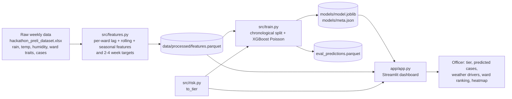
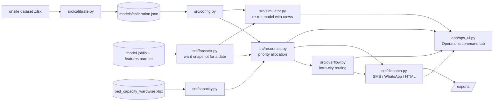

# dengAlert: Architecture

dengAlert gives public health officers a **2-to-4-week early warning** of dengue risk for each ward. It turns lagged weather and ward vulnerability into a predicted case count and a Low / Medium / High / Critical tier.

## 1. Data flow



**Stages**

1. **Ingest** (`src/features.py`): reads the weekly ward-level dataset (31,320 rows, 60 wards, 2016-2025).
2. **Feature engineering**: computed per `ward_id` on a time-sorted series, so no value crosses wards or comes from the future.
   - Rainfall lags 1 to 6 weeks, rolling rainfall sums over 2, 4 and 6 weeks, and the 2-4-week-ago rainfall window (the "vector breeding clock").
   - Temperature and humidity lags 1 to 4 weeks and 4-week means.
   - Seasonality as `week_sin`, `week_cos` and `month`.
   - Static ward vulnerability: `population_density_sqkm`, `water_logging_risk_index`, `sanitation_score`.
   - Target `y_2_4w`: total cases in the ward over weeks +2, +3 and +4.
3. **Train** (`src/train.py`): XGBoost regressor, evaluated against two baselines, then serialized with `joblib`.
4. **Risk tiers** (`src/risk.py`): predicted cases are mapped to tiers using three cutoffs saved in `models/meta.json`.
5. **Serve** (`app/app.py`): the Streamlit dashboard loads the saved model and features and scores every ward-week in one batch. Nothing is retrained when the app opens.

## 2. Chronological validation split

Dengue data is a time series, so rows are never shuffled. A random split would let the model learn from weeks after the ones it is tested on.

| Split | Period | Use |
|---|---|---|
| Train | 2016 to 2022 | Fit the model and learn tier cutoffs |
| Purge | last 4 weeks of 2022 | Removed from training |
| Validation | 2023 to 2024 | Early stopping (picks the number of trees) |
| Test | 2025 | Final, untouched evaluation |

**Why the purge:** the target looks up to 4 weeks ahead, so the last 4 training weeks have targets that overlap the validation period. Dropping them prevents that leak.

## 3. Model selection rationale

- **XGBoost with Poisson loss** (`count:poisson`). The target is a non-negative count with many zeros, and Poisson loss fits that better than squared error.
- **Gradient-boosted trees** handle the non-linear rain-to-cases lag and interactions between rainfall and ward vulnerability without feature scaling, and are fast at inference.
- **Early stopping on validation** chooses the tree count (about 345 to 403 trees across runs).
- **Baselines the model must beat:**
  - *Climatology*: the training average for that ward and calendar month.
  - *Persistence*: this week's cases carried forward over 3 weeks.

**Test results (2025, unseen):**

| Model | MAE | RMSE |
|---|---|---|
| XGBoost | 2.72 | 5.17 |
| Climatology | 3.34 | 5.93 |
| Persistence | 5.80 | 10.32 |

MAE and RMSE are in cases per 2-4 week window per ward. The model beats both baselines on the held-out year. The most influential features are 2-week rainfall (about 47% importance), 4-week mean humidity and seasonality, consistent with the rain-then-breeding-then-cases lag.

**Risk tiers.** Cutoffs are the 60th, 85th and 95th percentiles of the model's predictions on **training data only**, so no validation or test information shapes them. Tiers are therefore relative: Critical means a prediction in the top 5% of what the model has seen. The cutoffs are stored in `models/meta.json`, so the app and training always use the same rule.

**Explainability.** The dashboard shows per-forecast driver contributions from XGBoost's built-in SHAP values (`pred_contribs`), so officers see which weather lags pushed the risk up or down.

## 4. Compute and API cost controls

The system makes **no external API calls and uses no LLM at runtime**, so there are no token or per-request costs.

| Control | Where | Effect |
|---|---|---|
| Serialized model (`joblib`) | `models/model.joblib` | Inference only at runtime; no retraining on launch |
| Precomputed features | `data/processed/features.parquet` | The app reads a columnar file instead of recomputing lags |
| `st.cache_resource` | `load_model()` | Model and metadata are loaded once per server process |
| `st.cache_data` | `load_data()` | All ward-weeks are scored in one batch and cached; user clicks only filter existing results |
| Batch inference | `load_data()` | One `model.predict` call over the full table rather than one call per selection |
| Vectorised pandas/NumPy | `src/features.py`, `src/risk.py` | Grouped shifts and `np.digitize` instead of Python loops |
| Local-only execution | whole app | Runs on an ordinary office PC with no cloud service |

**Path to production.** In the onsite sprint, live weather would come from one scheduled fetch per day (for example, a single forecast-API call per city, cached to disk), not one call per user interaction. Features would be recomputed incrementally for the newest week only, and the model reloaded when `models/model.joblib` changes.

## 5. Limitations

- Tiers are percentile-based, not fixed clinical thresholds.
- The test set is one year (2025), so small metric differences are not reliable.
- The model uses weather, season and ward traits only. Lagged case counts are the likeliest next accuracy gain.
- Dashboard dates inside the training period are in-sample. The app labels them, and demos should use 2025 dates.

## 6. Repository layout (Phase 1)

```
app/app.py            Streamlit dashboard
src/features.py       lag and target pipeline
src/risk.py           tier mapping
src/train.py          chronological split, training, metrics
models/               model.joblib, meta.json
data/processed/       features.parquet, eval_predictions.parquet
```

## 7. Phase 2: Operations layer

Phase 2 extends the Phase 1 forecaster into an operational system for ward commissioners
and health-center managers. Phase 1 code, model and history are unchanged. Phase 2 adds
modules that take the model's ward forecasts and turn them into supply allocations, bed
routing, a crew what-if simulator and dispatch notices.

### 7.1 Data flow



**Build time (run once):** `python -m src.calibrate` writes `models/calibration.json`;
`python -m src.train` (Phase 1) writes the model. **Run time:** the app loads these local
files, scores every ward in one batch and runs Modules 1 to 4 on the chosen forecast date.

### 7.2 Demand conversion (`src/calibrate.py`, `src/config.py`)

Forecast cases are converted to supplies with ratios measured from the onsite dataset,
using the ratio of sums over ward-weeks with at least 5 cases (so rounding noise at tiny
counts does not bias them):

| Quantity | Rule | Source |
|---|---|---|
| Saline bags | cases x about 2.4 | measured from the dataset |
| Diagnostic kits | cases x about 1.17 | measured from the dataset |
| Hospital beds | cases / 3 x about 0.30 | measured; beds are occupied at the same time, so the 3-week total is converted to a weekly load |
| Spray crews needed | Critical 3, High 2, Medium 1, Low 0 | **assumption** |

The week shares used by the simulator (how window cases fall across weeks +2, +3, +4)
are also measured from history and stored in `calibration.json`.

### 7.3 Risk tiers

Tiers come from the model's predicted cases for the next 2-4 weeks, using cutoffs learned
from training predictions only (60th, 85th and 95th percentiles):

| Tier | Predicted cases |
|---|---|
| Low | below 3.1 |
| Medium | 3.1 to 22.3 |
| High | 22.3 to 33.9 |
| Critical | above 33.9 |

Tiers are relative rankings, not clinical thresholds.

### 7.4 Module 1: Constrained resource allocation (`src/resources.py`)

1. Convert each ward's predicted cases to saline, kits, beds and crews needed (7.2).
2. Score each ward:
   `priority = tier_weight x predicted_cases x (0.5 + density / max_density)`
   with tier weights Low 1, Medium 2, High 4, Critical 8. Tier and cases dominate; density
   adjusts the score between 0.5x and 1.5x, so crowded wards rank higher.
3. Set the pools. "Region" means all 60 wards across the five cities. The saline and kit
   pools equal stock% (slider, 30-100%) of total regional demand. The crew pool is the
   crew slider.
4. Sort wards by priority and fill the pools in that order. Each ward receives
   `min(its need, what is left)`, so the highest-priority wards are served completely first.
5. Any ward that receives less than it needs is flagged **CRITICAL SUPPLY DEFICIT**, with the
   short items listed.

This is strict-priority (greedy) allocation. It is deterministic and easy to audit, but it
is not a global optimum, and lower tiers can receive nothing when stock is very short.

### 7.5 Bed capacity (`data/raw/bed_capacity_wardwise.xlsx`, `src/capacity.py`)

The dataset gives beds required but no capacity, so capacity is an assumption built from
the public-hospital list supplied for the competition:

1. Count public hospitals located inside each city core (excluding rural upazila
   complexes): Chattogram 1,750 beds, Dhaka North 500, Dhaka South 2,500, Gazipur 500,
   Narayanganj 140.
2. Split each city's total across its wards in proportion to `population_density_sqkm`
   (ward population is not in the dataset).
3. `dengue_bed_capacity` = 10% of a ward's total beds, minimum 1. The 10% share is an
   assumption, because beds are shared with all other patients.

The stock slider also scales usable beds: `bed_capacity_eff = floor(dengue_bed_capacity x stock%)`.
This is our interpretation of "available stock".

### 7.6 Module 2: Cross-ward overflow routing (`src/overflow.py`)

Routing never crosses a city boundary. For each city:

1. A ward's net deficit is `max(0, beds_required - bed_capacity_eff)`.
2. Wards with a deficit are processed from the largest deficit down.
3. Each overflow patient is moved one at a time to the same-city ward with free beds that
   would end up least utilized, `(load + 1) / capacity`.
4. If no ward in the city has a free bed, the patient is counted as unplaced and the city
   is flagged for escalation.

Outputs: net deficit per ward, a transfer table (from, to, patients), headroom left per
ward and city-wide bed utilization. Routing is capacity-based; the dataset has no
distances, so travel time is not modeled.

### 7.7 Module 3: What-if vector-control simulator (`src/simulator.py`)

The counterfactual is model-driven: the trained model is re-run with crews applied.

1. **Crew effect (assumption).** Each crew removes breeding sites, which is represented by
   scaling down the model's rainfall inputs and the water-logging index by
   `exp(-effect x k)` for k crews. The default effect is 0.15 per crew (about 14% per crew),
   adjustable by the officer. The data has no spraying records, so this value cannot be
   learned.
2. **Curve.** For each ward and each k from 0 to 5 crews, the model predicts window cases
   from the scaled inputs. The curve is forced to be non-increasing in k.
3. **Deployment.** Auto mode gives crews out one at a time, each to the ward where one more
   crew prevents the most cases (greedy marginal gain, which gives diminishing returns).
   Manual mode lets the officer set crews per ward.
4. **Outcomes.** For each ward: `prevented = cases(0) - cases(k)` and
   `ROI = prevented / k` (cases prevented per crew). Beds and saline saved are computed
   with the same conversion functions as Module 1, so the numbers agree. Tiers before and
   after are shown, and wards are ranked by ROI.
5. **Weekly view.** The window reduction is divided across weeks +2, +3, +4 using the
   historical shares measured in `calibration.json`.

### 7.8 Module 4: Dispatch notices (`src/dispatch.py`)

Notices are fixed templates filled with numbers. No LLM is used. Each lists predicted
cases, allocated vs required saline, kits, beds and crews, deficit alerts and any patient
transfers:

- **SMS:** one short line per ward.
- **WhatsApp:** a short multi-line message with bold markers.
- **Printable brief:** a self-contained HTML table per city with a print stylesheet
  (Print > Save as PDF works offline).

`python -m src.make_exports` writes samples to `/exports`.

### 7.9 Module 5: Offline resilience

- Forecasting, allocation, routing, the simulator and the dispatch templates read only
  local files: the serialized model, `features.parquet`, `calibration.json` and the
  capacity workbook.
- No external API, no LLM and no web calls at runtime. Plots use Plotly without map tiles.
- The model is loaded once (`st.cache_resource`) and all wards are scored in one batch
  (`st.cache_data`), so interactions only filter cached results.
- Verified by running the app with the network disabled [confirm: date and method of the
  offline test].

### 7.10 Testing

`pytest tests` checks that allocation never exceeds stock, full stock removes supply
deficits, priority wards are served first, routing stays inside a city and conserves
patients, and the simulator is monotone and ranked by ROI.

### 7.11 Assumptions and limitations

- **Assumed, not measured:** crew effect size, crew need by tier, tier weights, the 10%
  dengue bed share, and reading "regional stock" as one pool for all wards.
- **Bed capacity** counts only the public hospitals in the supplied list, so Dhaka is
  under-counted and private hospitals are missing. Ward shares use density as a stand-in
  for population. Assigning Dhaka's hospitals between north and south is a judgement call.
- **Simulator:** it borrows the model's rain-to-cases relationship as a proxy for breeding
  sites. The weekly split is a fixed historical share, not a separate model per week.
- **Allocation and routing are greedy**, not globally optimal. Lower tiers can receive no
  supplies when stock is short.
- Tiers are percentile-based, and the test set is one year (see section 5).

### 7.12 Repository layout (Phase 2 additions)

```
app/ops_ui.py          Operations command tab
src/calibrate.py       data-derived conversion ratios
src/config.py          constants and assumptions
src/capacity.py        ward bed capacity loader
src/forecast.py        non-Streamlit scoring and ward snapshot
src/resources.py       Module 1: allocation
src/overflow.py        Module 2: routing
src/simulator.py       Module 3: crew what-if and ROI
src/dispatch.py        Module 4: SMS, WhatsApp, HTML
src/make_exports.py    writes /exports
models/calibration.json
data/raw/bed_capacity_wardwise.xlsx
tests/test_core.py
exports/               sample notices
```

### 7.13 How to run

```
python -m src.calibrate
python -m src.train
python -m streamlit run app/app.py
python -m src.make_exports
pytest tests
```

Live URL: [add]. Phase 2 commits are on branch/tag `version-onsite-final` [confirm].

## 8. AI use disclosure

[Fill in honestly.] Example: "Claude (Anthropic) was used to discuss the design, draft and
review code and documentation, and derive the bed-capacity workbook from the supplied
hospital list. All modeling choices, assumptions and results were reviewed and run by the
team, and the team can explain every module."
