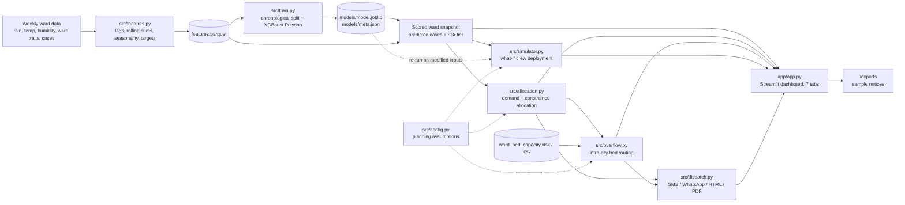

# dengAlert: Architecture

dengAlert gives public health officers a **2-to-4-week early warning** of dengue risk for each ward, and (Phase 2) turns that forecast into **supply allocation, hospital overflow routing, a vector-control what-if simulator and ready-to-send dispatch notices**. Everything runs locally: no external API and no LLM is needed at runtime.

- [1. System overview](#1-system-overview)
- [2. Phase 1: forecasting](#2-phase-1-forecasting)
- [3. Phase 2: operations layer](#3-phase-2-operations-layer)
- [4. Ward bed capacity data](#4-ward-bed-capacity-data)
- [5. Offline resilience](#5-offline-resilience)
- [6. Compute and API cost controls](#6-compute-and-api-cost-controls)
- [7. Assumptions and limitations](#7-assumptions-and-limitations)
- [8. Testing](#8-testing)
- [9. Repository layout](#9-repository-layout)
- [10. AI disclosure](#10-ai-disclosure)

## 1. System overview

The dashboard tabs are: Ward forecast, City overview, Model accuracy (Phase 1), then Resource allocation, Hospital overflow, Vector-control simulator, Dispatch (Phase 2). The sidebar holds the date selector and the scarcity controls (regional stock 30-100%, total spraying crews).

## 2. Phase 1: forecasting

### 2.1 Data flow
1. **Ingest** (`src/features.py`): weekly ward-level dataset (31,320 rows, 60 wards, 2016-2025).
2. **Feature engineering**, computed per `ward_id` on a time-sorted series so nothing crosses wards or comes from the future:
   - rainfall lags 1-6 weeks, rolling rainfall sums over 2, 4 and 6 weeks, and the 2-4-week-ago rainfall window (the vector breeding clock);
   - temperature and humidity lags 1-4 weeks and 4-week means;
   - seasonality (`week_sin`, `week_cos`, `month`);
   - static vulnerability (`population_density_sqkm`, `water_logging_risk_index`, `sanitation_score`);
   - target `y_2_4w`: total cases over weeks +2, +3 and +4.
3. **Train** (`src/train.py`): XGBoost regressor with Poisson loss, compared with two baselines, serialized with `joblib`.
4. **Risk tiers** (`src/risk.py`): predicted cases are mapped to Low / Medium / High / Critical with three cutoffs saved in `models/meta.json`.
5. **Serve** (`app/app.py`): loads the saved model and features and scores every ward-week in one batch. Nothing is retrained at launch.

### 2.2 Chronological validation split
Rows are never shuffled, because a random split would let the model learn from weeks after the ones it is tested on.

| Split | Period | Use |
|---|---|---|
| Train | 2016 to 2022 | Fit the model and learn tier cutoffs |
| Purge | last 4 weeks of 2022 | Removed (targets look 4 weeks ahead and would overlap validation) |
| Validation | 2023 to 2024 | Early stopping |
| Test | 2025 | Final, untouched evaluation |

### 2.3 Model choice and results
- **XGBoost, `count:poisson`**: the target is a non-negative count with many zeros; trees capture the non-linear rain-to-cases lag and its interaction with ward vulnerability.
- **Baselines the model must beat**: climatology (training mean for that ward and calendar month) and persistence (this week's cases carried forward).

| Model (2025 test) | MAE | RMSE |
|---|---|---|
| XGBoost | 2.72 | 5.17 |
| Climatology | 3.34 | 5.93 |
| Persistence | 5.80 | 10.32 |

MAE/RMSE are in cases per 2-4 week window per ward. The top features are 2-week rainfall (about 47% importance), 4-week mean humidity and seasonality.

**Tiers** use the 60th, 85th and 95th percentiles of predictions on training data only, so they are relative rather than clinical thresholds. **Explainability** comes from XGBoost's built-in SHAP values (`pred_contribs`), shown as per-forecast drivers.

## 3. Phase 2: operations layer

Phase 2 adds pure-Python modules under `src/`. They consume the scored ward snapshot (predicted cases, tier, density) and produce decisions. All tunable numbers live in `src/config.py`.

### 3.1 Constrained resource allocation (`src/allocation.py`)

**Demand conversion** (per ward, integers, rounded up):

| Resource | Formula (default values) |
|---|---|
| Admissions | predicted cases x 0.30 |
| `hospital_beds_required` | ceil(admissions x 5 days / 21-day window) |
| `saline_bags_needed` | ceil(admissions x 8) |
| `diagnostic_kits_needed` | ceil(predicted cases x 2) |
| Crews needed | max(ceil(cases / 25), tier minimum), minimums: Low 0, Medium 1, High 1, Critical 2 |

**Priority score** = predicted cases x tier weight x (density / median density)^0.5, with tier weights Low 1, Medium 2, High 3.5, Critical 5. High-risk, high-density wards rank first.

**Scarcity controls.** Full stock (100%) is the total demand of the busiest week in the last year. Available stock = full stock x slider (30-100%), rounded down. Crews are a fixed pool. Wards are filled in priority order: each gets `min(its demand, stock remaining)`. This is integer-exact: allocations never exceed stock and are never negative, and shortfalls fall on the lowest-priority wards.

**Deficit alerts.** Deficit = needed - allocated. A ward that is short and in the High or Critical tier is flagged `CRITICAL SUPPLY DEFICIT`; a short ward in any other tier is flagged `Deficit`. The dashboard shows a banner when any critical deficit exists.

### 3.2 Hospital surge and overflow routing (`src/overflow.py`)

For every ward:
- net deficit = max(beds required - bed capacity, 0)
- headroom = max(floor(0.90 x capacity) - beds required, 0), so a receiving ward is never filled above 90%.

Per city pool (Dhaka North, Dhaka South, Chattogram, Gazipur, Narayanganj, never across cities): wards with a deficit are processed largest first, and each sends patients to the same-city ward with the most remaining headroom until the deficit is cleared or headroom runs out. The output has net ward deficits, a transfer list (from, to, patients), final ward load, remaining headroom, city utilization (beds required / capacity) and unplaced overflow. A city with unplaced overflow is flagged `CITY OVER CAPACITY`.

### 3.3 What-if vector-control simulator (`src/simulator.py`)

The counterfactual is **model-driven**, not a fixed percentage:

1. Coverage = min(1, crews deployed / crews needed).
2. Crews remove breeding habitat: `water_logging_risk_index` is multiplied by (1 - 0.60 x coverage).
3. The trained XGBoost model is **re-run** on the modified row. Ratio = counterfactual prediction / baseline prediction.
4. The effect is spread over weeks +2, +3 and +4 with the profile (0.7, 1.0, 0.8): ramp-up, then spray decay.
5. Beds and saline are re-derived from the reduced case counts with the Section 3.1 formulas.
6. **ROI = cases prevented / crews deployed.** `rank_roi` ranks wards by the first crew's impact, and `best_deployment` places crews one at a time on the ward with the largest marginal gain.

### 3.4 Dispatch notices (`src/dispatch.py`)

Deterministic text templates, no LLM. Each ward notice lists predicted cases, allocated vs required saline, kits and crews, the bed requirement, deficit alerts and any transfer instructions. Formats: SMS (single message), WhatsApp (bold-formatted), printable HTML brief (print CSS) and PDF (`reportlab`). The HTML brief always works as the printable fallback if `reportlab` is missing. `export_all` writes the notices to `/exports`.

## 4. Ward bed capacity data

`bed_capacity` per ward comes from `ward_bed_capacity.xlsx` (also `ward_bed_capacity.csv`), built from the hospital-by-upazila list:

1. **Hospital to city, by real location.** Only hospitals inside a city-corporation area are used: Kotwali, Cantonment, Mugda Para (Dhaka); Kotwali, Panchlaish (Chattogram); Narayanganj Sadar; Gazipur Sadar. Hospitals in other upazilas are excluded.
2. **City to ward.** The source has no coordinates and the ward IDs have no boundaries, so the city pool is shared across wards in proportion to population density. Any hospital can be pinned to a specific ward by typing the ward ID in the `Hospital_Mapping` override column; its beds then go to that ward directly.
3. **Dengue-allocatable beds** = max(minimum, round(general beds x 10%)). The 10% share is an assumption set on the `Inputs` sheet.

## 5. Offline resilience

The forecast, allocation, overflow routing, simulator and dispatch templates need no network and no LLM. `python -m src.offline_check` disables sockets, runs the full chain (score, allocate, route, simulate, export) and prints `OFFLINE OK` when nothing tried to reach the network. The dashboard has no external fonts, tiles or API calls, and the PDF export uses a local library.

## 6. Compute and API cost controls

| Control | Where | Effect |
|---|---|---|
| Serialized model | `models/model.joblib` | Inference only at runtime |
| Precomputed features | `data/processed/features.parquet` | App reads a columnar file instead of recomputing lags |
| `st.cache_resource` / `st.cache_data` | `load_model()`, `load_data()` | Model loaded once; all ward-weeks scored in one batch |
| Vectorised pandas/NumPy | `src/features.py`, `src/risk.py` | No per-row Python loops in the forecast path |
| Local-only execution | whole app | No cloud service, no token cost |

The simulator makes two model calls per evaluation. `best_deployment` calls it once per crew, which stays fast at 60 wards.

## 7. Assumptions and limitations

- **Operational ratios are planning assumptions, not learned.** Admission rate (30%), length of stay (5 days), 8 saline bags per admission, 2 kits per case, 25 cases per crew, the 90% receiving cap, the 60% habitat reduction and the week profile are all editable in `src/config.py`.
- **Ward bed capacity is estimated.** Hospital location is exact only to city level; the ward split is density-based unless overridden. Private hospitals are not in the source list, and two Mugda 500-bed entries may be one institution.
- **Simulator sensitivity** depends on how strongly the model responds to `water_logging_risk_index`; effects are model-estimated, not measured field efficacy.
- Tiers are percentile-based, not clinical thresholds; the test set is one year (2025).
- Dashboard dates in the training period are in-sample; the app labels them and demos should use 2025 dates.

## 8. Testing

`python -m pytest tests` (or `python tests/test_phase2.py`) covers integer demand conversion, stock monotonicity and priority order, intra-city routing with patient conservation, simulator monotonicity and ROI ordering, and a full export run with sockets blocked. The tests use a stand-in model so they need neither XGBoost nor the trained artefacts.

## 9. Repository layout

├── notebooks/
├── src/
│   ├── __pycache__/
│   ├── __init__.py
│   ├── calibrate.py
│   ├── capacity.py
│   ├── config.py
│   ├── dispatch.py
│   ├── features.py
│   ├── forecast.py
│   ├── make_exports.py
│   ├── overflow.py
│   ├── resources.py
│   ├── risk.py
│   ├── simulator.py
│   └── train.py
├── tests/
│   ├── __pycache__/
│   └── test_core.py
├── .gitignore
├── ARCHITECTURE.md
├── main-rai.py
├── README.md
└── requirements.txt

## 10. AI disclosure

AI assistance (Claude, by Anthropic) was used for exploratory data analysis, drafting the Phase 2 modules, and drafting this document. The team reviewed the code, ran the tests, chose the planning assumptions and is responsible for the final submission. No AI or external API is called at runtime.
